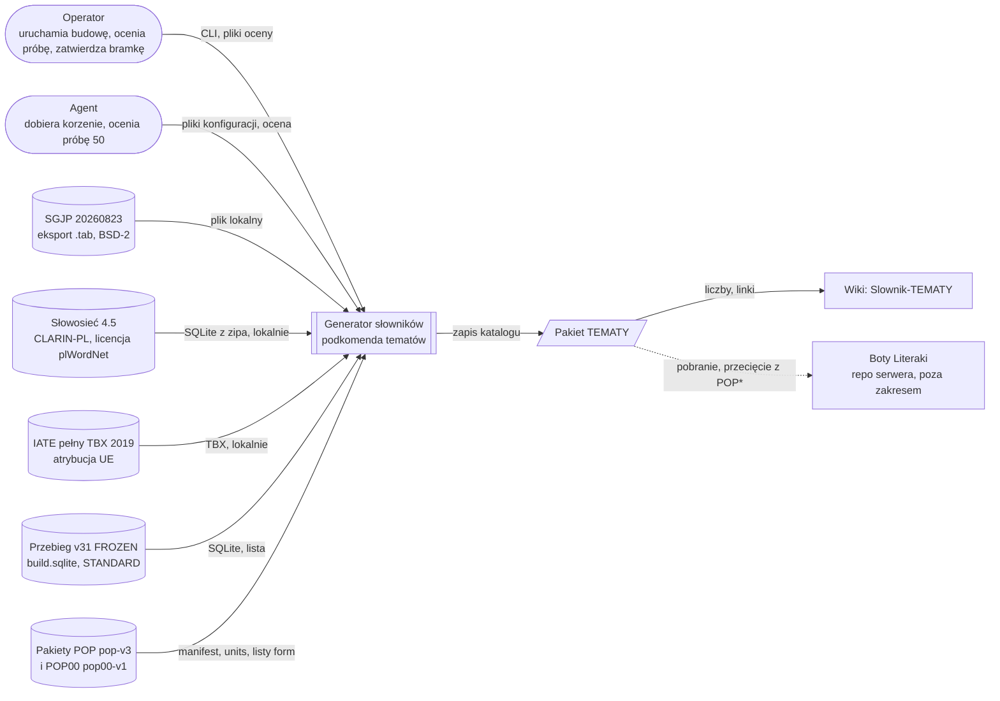
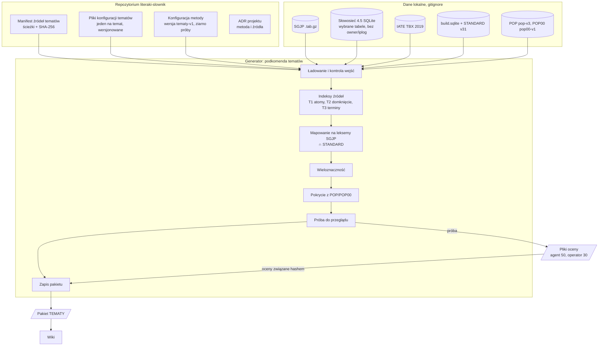

# Projekt wysokiego poziomu: słowniki tematyczne (pakiet TEMATY)

## TL;DR
Temat to podzbiór STANDARD, zbudowany wsadowo przez generator jako nowa podkomenda na wzór POP00.
Lista ma trzy warstwy: T1 etykiety SGJP, T2 drzewa Słowosieci 4.5 (hiponimia + części i miejsca), T3 słowa pojedyncze IATE 2019 i jawne dodatki.
Temat opisuje jeden plik konfiguracji. Jednostką jest leksem SGJP, a formy to jego formy ∩ STANDARD. Wieloznaczne wpisy dostają flagę `wieloznaczny`.
Pakiet podaje pokrycie z POP i POP00 jako % tematu oraz (diagnostycznie) pokrycie kandydatów z BROAD i STANDARD przed filtrem; w leksemach i formach, razem i na warstwę.
Pilotaż: morze, potem bramka. Po bramce ok. 10 tematów zatwierdzonych przez operatora.

## Key Decisions
- **Lista warstwowa T1/T2/T3.** Każdy wpis ma warstwę i źródło; odbiorca może odciąć słabszą warstwę (ADR-001).
- **Metody spoza Zadania E, statusy E1/E2/E3 zapisane w ADR.** E1 słaba, E2 zablokowana, E3 (LLM) odroczona (ADR-002).
- **Nowe źródła: Słowosieć 4.5 i IATE 2019.** Noty w `ATTRIBUTIONS.md`; surowego zrzutu Słowosieci nie publikujemy (ADR-003, ADR-004).
- **Temat = plik konfiguracji, przegląd R2.** Agent: 50 na warstwę; operator: 30 z nich; zgodność zapisana (ADR-005).
- **Leksem SGJP, formy ∩ STANDARD, flaga `wieloznaczny`.** Odbiorca sam przecina z POP/POP0/POP00 (ADR-006, ADR-007).
- **Jeden pakiet TEMATY i jedna strona wiki `Slownik-TEMATY`** (ADR-008).
- **Pokrycie z POP i POP00 w manifeście i na wiki.** Liczba główna w leksemach, druga w formach; wersje POP i POP00 przypięte hashami (ADR-009).
- **Diagnostyka kandydatów wobec BROAD i STANDARD.** Liczona przed filtrem ∩ STANDARD, bez progu; ile kandydatów odpada i dlaczego, z przykładami. Lista wydana zostaje ∩ STANDARD (ADR-009).
- **Pilotaż morze, bramka z progami.** Progi to propozycja do zatwierdzenia (ADR-010).

## Open Questions / Risks
- **Licencja Słowosieci 4.5.** Użytkownik ją przyjął, mimo linku 404 i noty „4.2 © 2020”. Ryzyko zostaje i trafia do `LIMITATIONS.md`.
- **Jeden oceniający przy korzeniach.** Korzenie wybiera agent. Drugi oceniający (operator) widzi tylko próbę 30 na warstwę.
- **IATE 2019 jest stare** i ma dziedzinę „transport morski i śródlądowy” (4821). Część haseł dotyczy rzek i kanałów. Trafności IATE nie zmierzono w badaniu.
- **Pokrycie T2 z samymi częściami i miejscami jest niezmierzone.** Badanie mierzyło A (24%) i C ze skojarzeniami (59%) dla morza. Wynik pilotażu leży gdzieś pomiędzy.
- **Rolnictwo** zostaje poza pierwszą falą do czasu lepszych korzeni (40% pokrycia w badaniu).
- **Pokrycie z POP00 w leksemach jest równe pokryciu z POP0.** POP00 zachowuje każdy leksem POP0 (ADR-009 projektu). Informację niesie liczba w formach.
- **Progi bramki to propozycja.** Operator może je zmienić przed pilotażem.
- **Kandydat bez leksemu SGJP nie ma form.** W diagnostyce liczymy go osobno, w lematach (`BRAK_LEKSEMU`), poza udziałami w leksemach i formach.

## Design Overview
**Kontekst.** Prompt v3 (Zadanie E) przewiduje słowniki tematyczne jako dodatek do wiedzy bota. Badanie pokazało, że żadne jedno źródło nie wystarcza. Etykiety SGJP są trafne, ale wąskie. Słowosieć daje słowa podstawowe. IATE dokłada terminy. Korzystają boty Literaki (osobne repozytorium) i odwiedzający wiki.

**Podejście.** **Wsadowy, deterministyczny potok** w istniejącym generatorze Pythona, na wzór **POP00**. Wejścia są lokalne i przypięte hashami. Temat opisuje **plik konfiguracji**. Kod jest wspólny dla wszystkich tematów. Wynik to **lista warstwowa leksemów SGJP** ⊆ STANDARD. Każdy wpis ma warstwę, źródła, znaczenie źródłowe i flagę `wieloznaczny`. Pakiet **TEMATY** ma plik na temat, `method.json`, `LIMITATIONS.md`, `ATTRIBUTIONS.md` i manifest z liczbami, pokryciem z POP i POP00 oraz hashami.

**Kluczowe decyzje:**
- Warstwy zamiast jednej listy: trafność widać osobno (T1 ~29/30, T2 ~23/30 w badaniu).
- Słowosieć tylko przez hiponimię (rel. 11) oraz części i miejsca (rel. 25, 27). Bez skojarzeń (rel. 108, 146), bo połowa z nich to szum.
- IATE: pełny TBX z 2019 r., bez konta EU Login (żadnego kontaktu ani logowania).
- Temat jest podzbiorem bazy. Jawny dodatek spoza bazy zatrzymuje budowę.
- Pokrycie z POP/POP00 podajemy, ale nie przecinamy. Przecięcie robi odbiorca.
- Bez LLM i bez płatnych usług.

## Architektura

### Kontekst systemu (C4, poziom 1)

Wszystkie źródła leżą lokalnie, w katalogach wykluczonych z repozytorium. Nic nie idzie do sieci w czasie budowy.

### Kontenery (C4, poziom 2)

- **Pliki konfiguracji tematów:** definicja tematu bez kodu.
- **Manifest źródeł:** przypina SGJP, Słowosieć, IATE, przebieg v31, POP i POP00 hashami. Zmiana pliku = błąd budowy.
- **Generator:** jeden przebieg na pakiet. Działa offline i deterministycznie, bez bazy serwera.
- **Pliki oceny:** osobne wejście drugiego kroku. Pakiet bez ocen ma stan BUILT, z ocenami REVIEWED.
- **Pakiet TEMATY:** nowy, nieistniejący katalog; nigdy nie nadpisujemy.

## Główne składniki

| Składnik | Cel | Odpowiedzialność | Interfejs | Zależy od |
|---|---|---|---|---|
| Ładowanie wejść | Pewność, że wynik pochodzi z przypiętych danych | sprawdza SHA-256 wszystkich wejść; sprawdza stan FROZEN przebiegu; czyta konfiguracje tematów; odrzuca nieznane pola | manifest źródeł, konfiguracje | pliki lokalne |
| Indeks T1 (SGJP) | Rdzeń terminów | dzieli kwalifikatory najpierw po `\|`, potem po `,`; wybiera leksemy z atomami tematu | atomy z konfiguracji | `build.sqlite` |
| Indeks T2 (Słowosieć) | Słowa podstawowe tematu | domknięcie hiponimii od korzeni; części i miejsca (rel. 25, 27) z ich hiponimami; odcina wykluczone poddrzewa; zapisuje synset źródłowy | korzenie, relacje, wykluczenia | SQLite Słowosieci 4.5 |
| Indeks T3 (IATE + dodatki) | Terminy i łaty | bierze polskie hasła jednowyrazowe z kodów dziedzin; dokłada jawne dodatki | kody dziedzin, lista dodatków | TBX 2019 |
| Mapowanie | Temat ⊆ baza | lemat + część mowy → leksemy SGJP; formy ∩ STANDARD; brak w bazie: kandydat odpada z powodem, a jawny dodatek zatrzymuje budowę | kandydaci z T1–T3 | przebieg v31 |
| Wieloznaczność | Uczciwy zapis niepewności | ustawia `wieloznaczny` i zapisuje znaczenie źródłowe | wpisy po mapowaniu | Słowosieć, SGJP |
| Diagnostyka bazy | Ile kandydatów w ogóle się przyda | przed filtrem ∩ STANDARD liczy kandydatów w BROAD i STANDARD, w leksemach i formach, razem i na warstwę; liczy odrzuconych z powodem i daje przykłady | kandydaci po mapowaniu | listy BROAD i STANDARD v31 |
| Pokrycie z POP/POP00 | Ile tematu jest „grywalne” | liczy % tematu w POP i POP00, w leksemach i formach, razem i na warstwę | wpisy, pakiety POP | POP pop-v3, POP00 pop00-v1 |
| Próba i przegląd | Trafność widoczna dla operatora | deterministyczna próba 50 na warstwę; podzbiór 30 dla operatora; liczy trafność i zgodność | pliki oceny | ziarno w konfiguracji metody |
| Zapis pakietu | Wydanie odtwarzalne | pisze pliki tematów, `method.json`, noty, raporty, manifest z hashami | katalog wyjściowy | wszystkie powyżej |

## Przepływ danych
```mermaid
flowchart LR
  A[Źródła lokalne<br/>SGJP, Słowosieć 4.5, IATE 2019] --> B[Normalizacja<br/>NFC, małe litery, jedno słowo,<br/>podział kwalifikatorów | potem ,]
  B --> C[Kandydaci per warstwa<br/>T1 atomy, T2 domknięcie, T3 terminy + dodatki]
  C --> D[Mapowanie na leksem SGJP<br/>lemat + część mowy]
  D --> DX[Diagnostyka: kandydaci ∩ BROAD, ∩ STANDARD<br/>leksemy i formy, T1/T2/T3, odrzuceni z przykładami]
  DX --> E[∩ STANDARD v31<br/>formy leksemu]
  E --> F[Indeks tematu<br/>warstwa = najniższa, źródła = wszystkie<br/>wieloznaczny, znaczenie źródłowe]
  F --> G[Pokrycie z POP i POP00<br/>leksemy i formy, razem i T1/T2/T3]
  G --> H[Próba 50 na warstwę<br/>operator 30]
  H --> I[Pakiet TEMATY<br/>manifest, method.json, noty]
  I --> J[Wiki Slownik-TEMATY]
```
1. **Wejście.** Tylko pliki przypięte w manifeście źródeł. Słowosieć czytamy z lokalnej bazy SQLite z wybranymi tabelami. Tabel z nazwiskami redaktorów (`owner`) i logu IP nie kopiujemy dalej.
2. **Normalizacja.** Wszystkie warstwy przyjmują tylko lematy jednowyrazowe z małych liter polskich. Kwalifikatory SGJP dzielimy najpierw po `|`, potem po `,`. Obecny podział w ładowaniu leksemów POP (tylko `,`) nie wystarcza.
3. **Kandydaci.** T1: leksemy z atomem tematu. T2: lematy jednostek z domknięcia. T3: hasła IATE (term jednowyrazowy w kodach dziedzin) oraz jawne dodatki.
4. **Mapowanie.** Lemat i część mowy wskazują leksemy SGJP. Kandydat odpada z powodem `BRAK_LEKSEMU`, `POZA_BROAD` albo `POZA_STANDARD`; przedtem liczymy diagnostykę. Dodatek spoza STANDARD zatrzymuje budowę.
5. **Scalenie.** Wpis to leksem SGJP. Gdy wpada z kilku warstw, dostaje najniższą (T1 < T2 < T3) i listę wszystkich źródeł. Dzięki temu warstwy są rozłączne, a ich suma daje całość.
6. **Pokrycie.** Przed filtrem liczymy diagnostykę BROAD/STANDARD. Po filtrze liczymy udział w POP i POP00. Oba opisane niżej.
7. **Przegląd.** Próba idzie do plików oceny. Wyniki wracają do pakietu, związane hashem listy.
8. **Wyjście.** Pakiet w nowym katalogu. Liczby na wiki bierzemy z manifestu.

### Pokrycie z POP i POP00 (wymóg użytkownika)
- **Wzór:** udział = |temat ∩ X| / |temat|, dla X = POP i X = POP00. Obok udziału zawsze liczba bezwzględna |temat ∩ X| i |temat|.
- **Liczba główna: leksemy.** POP i POP0 wybierają leksemy, a Zadanie E klasyfikuje leksemy. Udział w formach zależy od wielkości paradygmatu: czasownik ma dziesiątki form, rzeczownik kilkanaście. Formy podajemy jako drugą liczbę.
- **Leksem w POP:** członek POP w `reports/units.json` pakietu pop-v3. **Leksem w POP00:** członek POP0 z tego samego pliku, bo POP00 dziedziczy leksemy POP0 i każdy zachowuje formę (ADR-009 projektu). Zatem w leksemach POP00 = POP0. Różnicę widać w formach.
- **Forma w POP / POP00:** napis z listy form tematu obecny na liście form POP / POP00.
- **Zakres:** dla każdego tematu: całość oraz T1, T2, T3 osobno (warstwy rozłączne, wg reguły „najniższa warstwa”).
- **Gdzie:** manifest pakietu (`counts.<temat>.overlap`), raport podsumowania, strona wiki (tabela na temat), raport bramki pilotażu.
- **Przypięcie:** manifest źródeł przypina SHA-256 manifestu pakietu POP pop-v3 (dziś `4acb7014…1d58`) i manifestu pakietu POP00 pop00-v1. Pakiet TEMATY powtarza oba hashe i wersje metod.
- **Bez zmiany D4:** pliki tematu dalej zawierają pełny temat ∩ STANDARD. Odbiorca nadal sam przecina z POP/POP0/POP00.

### Diagnostyka: kandydaci wobec BROAD i STANDARD (wymóg użytkownika)
- **Po co:** słowo spoza STANDARD (albo BROAD) jest na końcu bezużyteczne. Chcemy wiedzieć, ile pracy źródła się marnuje.
- **Kiedy:** na zbiorze kandydatów **przed** filtrem ∩ STANDARD. Po filtrze udział STANDARD byłby zawsze 100%.
- **Co, dla każdego tematu, razem i T1/T2/T3:** |kandydaci|, |∩ BROAD|, |∩ STANDARD| i udziały |∩ X| / |kandydaci|; w leksemach (liczba główna) i w formach. Warstwa kandydata: ta sama reguła „najniższa warstwa”.
- **Definicje:** leksem jest w X, gdy ma co najmniej jedną formę na liście X. Forma jest w X, gdy jej napis jest na liście X. Formy kandydata to formy leksemu SGJP.
- **Odrzuceni:** liczba i do 10 przykładów na powód i warstwę: `BRAK_LEKSEMU` (lematu nie ma w SGJP; liczony w lematach, poza udziałami), `POZA_BROAD`, `POZA_STANDARD` (w BROAD, nie w STANDARD).
- **Gdzie:** `reports/summary.json`, raport bramki pilotażu, krótka wzmianka na wiki (jedno zdanie i udziały razem na temat). Nie w manifeście jako liczba główna; bez progu.
- **Przypięcie:** manifest źródeł przypina przebieg v31 (manifest przebiegu, listę STANDARD `dab4f3bc…fa7d` i listę BROAD); pakiet TEMATY powtarza wersje i hashe.
- **Bez zmiany decyzji:** lista wydana zostaje ∩ STANDARD.

## Schemat pliku konfiguracji tematu
Jeden plik JSON na temat. Nieznane pole = błąd budowy. Zmiana pliku = nowa wersja tematu.

| Pole | Typ | Znaczenie |
|---|---|---|
| `id`, `nazwa`, `wersja` | tekst | np. `morze`, „Morze i żegluga”, `morze-v1` |
| `t1.atomy_sgjp` | lista | atomy kwalifikatorów SGJP, np. `mors.`, `żegl.`, `ryb.` |
| `t2.korzenie` | lista {`synset`, `nazwa`} | id synsetu Słowosieci 4.5 i jego nazwa do kontroli (nazwa musi się zgadzać) |
| `t2.relacje` | lista liczb | dozwolone: 11 (hiponimia), 25, 27 (części, miejsca). Inne = błąd |
| `t2.wykluczenia_poddrzew` | lista {`synset`, `nazwa`, `powód`} | odcina gałąź drzewa |
| `t3.iate.kody_dziedzin` | lista | kody EuroVoc w IATE, np. 4821 |
| `t3.iate.filtry` | obiekt | typ terminu = term, jedno słowo; minimalna niezawodność (propozycja: ≥3) |
| `t3.dodatki` | lista {`lemat`, `czesc_mowy`, `powód`} | muszą być w bazie; inaczej błąd |
| `wykluczenia` | lista {`lemat`, `czesc_mowy`, `powód`} | usuwa wpis z każdej warstwy |
| `uwagi` | tekst | granice tematu, decyzje redakcyjne |

Przykład (pilotaż, skrót; korzenie z pomiaru w badaniu):
```json
{
  "id": "morze", "nazwa": "Morze i żegluga", "wersja": "morze-v1",
  "t1": {"atomy_sgjp": ["mors.", "żegl.", "ryb."]},
  "t2": {
    "korzenie": [{"synset": 7354, "nazwa": "statek 1"}, {"synset": 2149, "nazwa": "okręt 1"},
                 {"synset": 4511, "nazwa": "łódź 2"}, {"synset": 6214, "nazwa": "marynarz 1"},
                 {"synset": 14136, "nazwa": "żegluga 1"}, {"synset": 14515, "nazwa": "żeglarstwo 1"}],
    "relacje": [11, 25, 27],
    "wykluczenia_poddrzew": []
  },
  "t3": {"iate": {"kody_dziedzin": ["4821"], "filtry": {"typ": "term", "jedno_slowo": true, "niezawodnosc_min": 3}},
         "dodatki": [{"lemat": "sztorm", "czesc_mowy": "subst", "powód": "leży pod 'wiatr', poza drzewem"}]},
  "wykluczenia": [],
  "uwagi": "Bez żeglugi śródlądowej, jeśli przegląd tak zdecyduje."
}
```

## Układ pakietu TEMATY
| Plik | Zawartość |
|---|---|
| `release-manifest.json` | rodzaj pakietu, metoda `tematy-v1`, hashe wszystkich wejść (w tym POP, POP00), hashe plików, tożsamość kodu, `counts` na temat i warstwę, `overlap` z POP i POP00, stan BUILT/REVIEWED |
| `method.json` | kopia konfiguracji metody: wersja, ziarno próby, rozmiary prób, wydanie Słowosieci, data TBX IATE |
| `tematy/<id>.json` | kopia konfiguracji tematu użytej w budowie |
| `<ID>.tsv.gz` | jeden wiersz na leksem: klucz SGJP, lemat, część mowy, warstwa, źródła, znaczenie źródłowe, `wieloznaczny` |
| `<ID>.txt.gz` | formy tematu ∩ STANDARD, jedna na wiersz |
| `reports/summary.json` | liczby, pokrycie z POP/POP00, diagnostyka kandydatów wobec BROAD i STANDARD, odrzuceni z powodami i przykładami |
| `reports/review-<id>.json` | próba, oceny agenta i operatora, trafność, zgodność |
| `LIMITATIONS.md` | jeden oceniający przy korzeniach, wiek IATE, wersja licencji Słowosieci, temat per leksem, nie per znaczenie |
| `ATTRIBUTIONS.md` | SGJP (BSD-2), nota copyright i zastrzeżenie plWordNet, „Download IATE, European Union, 2019” |

## Przegląd (R2)
1. Generator losuje deterministycznie 50 wpisów na warstwę i temat (ziarno w `method.json`).
2. Agent ocenia każdy: trafne / wątpliwe / błędne, z krótkim powodem.
3. Z tych 50 generator wybiera deterministycznie 30. Operator ocenia je bez wglądu w oceny agenta.
4. Zapisujemy trafność obu i zgodność (odsetek zgodnych ocen oraz kappa Cohena).
5. Błędy systemowe naprawiamy w konfiguracji (wykluczenie, nowy korzeń, dodatek), nie ręcznie w liście. Potem nowa budowa i nowa próba.
6. Oceny są związane hashem pliku tematu. Po zmianie listy stara ocena nie pasuje.

## Bramka po pilotażu (propozycja progów)
Pilotaż: temat morze, wszystkie trzy warstwy. Raport bramki zawiera:

| Kryterium | Propozycja progu | Podstawa |
|---|---|---|
| Pokrycie 37 słów oczywistych morza | ≥ 70% | badanie: A 24%, C 59%, SGJP ∪ C 78% |
| Trafność T1 (operator, 30) | ≥ 27/30 trafnych | badanie 29/30 |
| Trafność T2 (operator, 30) | ≥ 20/30 trafnych, ≤ 3/30 błędnych | badanie A 23/30 |
| Trafność T3 (operator, 30) | ≥ 20/30 trafnych | niezmierzone; jak T2 |
| Zgodność agent–operator | ≥ 80% zgodnych ocen | ocena jednego oceniającego była ryzykiem |
| Odtworzenie | dwie budowy, identyczne hashe plików | wzór POP00 |
| Noty i zrzut | noty w `ATTRIBUTIONS.md`; brak danych redaktorów i IP w pakiecie | ADR-003 |
| Pokrycie z POP i POP00 | tylko raport, bez progu; leksemy i formy, razem i T1/T2/T3 | wymóg użytkownika |
| Kandydaci ∩ BROAD i ∩ STANDARD (przed filtrem) | tylko diagnostyka, bez progu; leksemy i formy, razem i T1/T2/T3; odrzuceni z przykładami | wymóg użytkownika |
| Udział `wieloznaczny` | tylko raport, z 10 przykładami | reguła H1 |

Decyzje bramki: „dalej” (operator zatwierdza listę ok. 10 tematów), „popraw” (zmiana konfiguracji, nowa próba) albo „stop” (warstwa wypada z metody). Proponowana fala: zwierzęta, rośliny, morze, medycyna i ciało, muzyka, kuchnia, sport, matematyka, pogoda, grzyby. Rolnictwo po lepszych korzeniach.

## Punkty integracji
- **Generator (CLI):** nowa podkomenda obok `pop` i `pop00`; ta sama koperta JSON odpowiedzi i obsługa błędów.
- **Przebieg v31 FROZEN:** odczyt `build.sqlite` (leksemy, interpretacje, kwalifikatory) oraz list STANDARD i BROAD (BROAD tylko do diagnostyki).
- **Pakiety POP pop-v3 i POP00 pop00-v1:** odczyt `reports/units.json` i list form; tylko do raportu pokrycia.
- **Słowosieć 4.5:** lokalna baza SQLite z relacjami 11, 25, 27, synsetami i jednostkami.
- **IATE:** lokalny TBX z 2019 r.; generator czyta tylko polskie terminy w wybranych kodach dziedzin.
- **Polecenie `explain`:** rozszerzenie o wariant tematu (dlaczego słowo jest w temacie: warstwa, źródło, synset). Przydaje się do przykładów na wiki.
- **Wiki:** strona `Slownik-TEMATY` (założona „W przygotowaniu” na starcie), wiersz na `Home`, `_Sidebar`, `Historia-zmian`, link ze `Slownik-STANDARD`. Strona podaje pokrycie z POP/POP00 i jednym zdaniem diagnostykę BROAD/STANDARD.
- **ADR projektu:** dwa nowe pliki w katalogu ADR (propozycja: ADR-010 metoda, ADR-011 źródła; zob. log decyzji).

## Decyzje projektowe
| ADR | Decyzja | Odpowiednik w repo |
|---|---|---|
| [ADR-001](decision-log.md#adr-001) | Lista warstwowa T1/T2/T3 | ADR-010 |
| [ADR-002](decision-log.md#adr-002) | Metody spoza Zadania E; E1 słaba, E2 zablokowana, E3 odroczona | ADR-010 |
| [ADR-003](decision-log.md#adr-003) | Słowosieć 4.5 jako źródło, nota, bez zrzutu | ADR-011 |
| [ADR-004](decision-log.md#adr-004) | IATE pełny TBX 2019 jako źródło T3 | ADR-011 |
| [ADR-005](decision-log.md#adr-005) | Temat = plik konfiguracji; przegląd R2 | ADR-010 |
| [ADR-006](decision-log.md#adr-006) | Jednostka: leksem SGJP; formy ∩ STANDARD | ADR-010 |
| [ADR-007](decision-log.md#adr-007) | Reguła `wieloznaczny` | ADR-010 |
| [ADR-008](decision-log.md#adr-008) | Jeden pakiet TEMATY, jedna strona wiki | ADR-010 |
| [ADR-009](decision-log.md#adr-009) | Raport pokrycia z POP i POP00; diagnostyka BROAD i STANDARD | ADR-010 |
| [ADR-010](decision-log.md#adr-010) | Pilotaż morze i bramka | ADR-010 |

## Przykłady
1. **Trzy warstwy w jednym temacie.**
   *Dane:* konfiguracja `morze-v1` jak wyżej.
   *Gdy:* operator uruchamia budowę.
   *Wtedy:* `achtersztag` ma warstwę T1 (`żegl.` w SGJP). `kotwica` ma T2 (część statku, rel. 25) i źródło z id synsetu. `szpigat` ma T3 (IATE 4821). Każdy z nich jest w STANDARD. Manifest podaje liczby T1/T2/T3 i ich udział w POP i POP00.
2. **Wieloznaczne słowo.**
   *Dane:* lemat `kiosk` wpada do T2 jako część okrętu podwodnego (rel. 25).
   *Gdy:* składnik wieloznaczności widzi w Słowosieci znaczenie `kiosk` (budka z gazetami) poza domknięciem tematu.
   *Wtedy:* wpis ma `wieloznaczny = tak` i synset źródłowy. Przegląd może go wykluczyć wpisem w konfiguracji; lista nie zmienia się ręcznie.
3. **Dodatek spoza bazy.**
   *Dane:* `t3.dodatki` zawiera lemat, którego nie ma w STANDARD v31.
   *Gdy:* trwa budowa.
   *Wtedy:* budowa kończy się błędem z nazwą lematu. Pakiet nie powstaje (temat ⊆ STANDARD).
4. **Pokrycie z POP i POP00.**
   *Dane:* zbudowany temat morze.
   *Gdy:* operator czyta manifest albo stronę wiki.
   *Wtedy:* widzi np. „T1: N leksemów, x% w POP, y% w POP00 (leksemy); formy: …”. Spodziewamy się, że T1 (terminy) ma niższy udział w POP niż T2. Liczby pochodzą z manifestu, nie z ręki.
5. **Diagnostyka przed filtrem.**
   *Dane:* T3 morza ma kandydatów z IATE.
   *Gdy:* generator liczy diagnostykę przed ∩ STANDARD.
   *Wtedy:* `reports/summary.json` podaje dla T3 np. „N kandydatów (leksemy); x% w BROAD, y% w STANDARD”, liczbę `BRAK_LEKSEMU`, `POZA_BROAD`, `POZA_STANDARD` i przykłady. Wydana lista T3 zawiera tylko leksemy w STANDARD.
6. **Nowy temat bez kodu.**
   *Dane:* bramka zaliczona; operator zatwierdza `grzyby`.
   *Gdy:* agent dodaje plik `grzyby` (atom `mikol.`, korzenie Słowosieci) i buduje pakiet.
   *Wtedy:* nowy plik tematu w pakiecie, nowa tabela na wiki. Kod się nie zmienia.

## Poza zakresem
- LLM (E3), także model o otwartych wagach. Wymaga dwóch potwierdzeń kosztu.
- Wikisłownik, AGROVOC, Słowosieć 5.0, konto EU Login.
- Terminy wielowyrazowe i listy na poziomie znaczeń.
- Osobne listy na bazę (BROAD, POP0) i przecięcie z POP w plikach tematu (tylko raport pokrycia).
- Ranking frekwencji wewnątrz tematu.
- Użycie list w botach Literaki (osobne zadanie w repozytorium serwera).
- Zmiana reguł gry, polityki list ani kryteriów dopuszczalności.
- Rolnictwo w pierwszej fali.

## Kryteria sukcesu
1. Dwie budowy z tych samych wejść dają identyczne hashe wszystkich plików pakietu.
2. Każdy wpis każdego tematu jest leksemem w STANDARD v31, ma warstwę, źródło i wartość `wieloznaczny`.
3. Manifest i wiki podają dla każdego tematu i warstwy: liczbę leksemów i form oraz udział w POP i POP00 (leksemy główne, formy obok), z przypiętymi wersjami POP i POP00.
4. `reports/summary.json` i raport bramki podają diagnostykę kandydatów wobec BROAD i STANDARD przed filtrem (leksemy i formy, razem i na warstwę, odrzuceni z przykładami), z przypiętymi wersjami list.
5. Pilotaż morze spełnia progi bramki zatwierdzone przez operatora.
6. Nowy temat wymaga tylko nowego pliku konfiguracji.
7. `ATTRIBUTIONS.md` zawiera notę i zastrzeżenie plWordNet oraz atrybucję IATE. Pakiet nie zawiera danych redaktorów ani logu IP.
