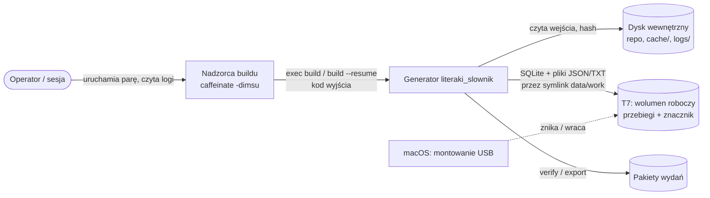
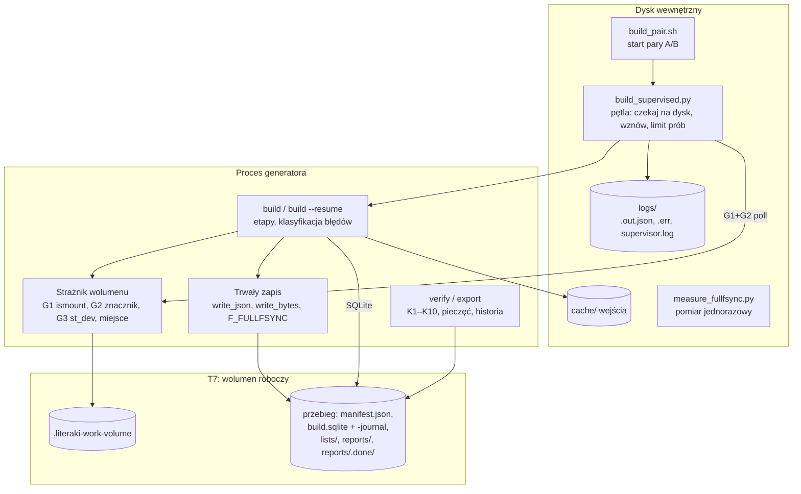

# Projekt: build na T7 z wznawianiem po zniknięciu dysku

Typ: high-level design · Data: 2026-11-23 · Kod: `literaki-slownik` @ `b31246e` · Decyzje: [decision-log.md](decision-log.md)

## TL;DR
Katalog `data/work` to symlink na T7. Strażnik w kodzie (G1 `ismount`, G2 znacznik na wolumenie, G3 `st_dev`) zamienia każdy brak dysku w kod wyjścia **75**.
`build --resume` wznawia od bieżącego etapu w tej samej bazie, a w `reports` od bieżącego raportu.
Nadzorca czeka na powrót dysku i sam uruchamia `--resume` (do 3 prób). Inne błędy zatrzymują pracę.
Trwałość: `F_FULLFSYNC` w zapisach plików, `fullfsync` w SQLite według pomiaru, `quick_check` po każdym wznowieniu.
Test „wznowiony = świeży” i historia prób w manifeście pilnują, że wynik się nie zmienia.

## Key Decisions
- Symlink `data/work` → wolumen roboczy na T7. `.gitignore` bez ukośnika, logi na dysku wewnętrznym ([ADR-001](decision-log.md#adr-001)).
- Strażnik G1+G2+G3 w kodzie buildu. Identyfikator wolumenu jest tylko na wolumenie, nie w repo ([ADR-002](decision-log.md#adr-002)).
- Wznawianie per etap w tej samej bazie, z odbudową tabel etapu nieidempotentnego ([ADR-003](decision-log.md#adr-003)).
- Znaczniki per raport w `reports/.done/`. `unresolved` wczytywany z pliku ([ADR-004](decision-log.md#adr-004)).
- Kontrakt kodów wyjścia. Nadzorca ponawia tylko kod 75 ([ADR-005](decision-log.md#adr-005), [ADR-006](decision-log.md#adr-006)).
- Pełny `fullfsync`, jeśli kosztuje ≤5%, inaczej tylko na granicach etapów. Zawsze `F_FULLFSYNC` i fsync katalogu w plikach ([ADR-007](decision-log.md#adr-007)).
- Historia prób leży w manifeście, objęta pieczęcią, ale poza K8 ([ADR-008](decision-log.md#adr-008)).

## Open Questions / Risks
- **Koszt `fullfsync` na T7 i czas `quick_check` dla 21 GB są niezmierzone.** Krok 2 mierzy jedno i drugie, zanim zapadnie wybór 4B/4C.
- **Mostek USB może przestawiać zapisy.** Wtedy `quick_check` wykryje szkodę, nadzorca stanie (kod 77) i trzeba budować od zera. Migawki (3C) są odłożone.
- **Zniknięcie dysku przerywa A i B naraz, w tym samym etapie.** Para nie złapie błędu wznowienia, który dotyka obu stron. Chroni przed tym tylko test z kroku 6.
- **Odbudowa tabel importu może zmienić `rowid` lub kolejność.** Jeśli test pokaże różnicę `logical_content`, import wznawia się od `preflight` w nowym pliku bazy (strata ~2,7 h).
- **Normalny czas `decisions` jest nieznany** (w v32 trwał 61 h). Jeśli etap jest długi, wraca cięcie od środka (2C).
- **Time Machine pisze na ten sam kontener APFS co build.** To dodatkowe I/O w trakcie buildu. Niezmierzone.
- **Zależność:** piny POP/POP00/TEMATY wskazują usunięty `lists-v31-20261012-162111-a`. To osobna decyzja właściciela; ten projekt jej nie rozstrzyga.
- **Prywatność przed commitem:** artefakty fazy 1 `analysis/findings/external-sqlite-macos.md`, `analysis/findings/codebase-paths-inventory.md` i `analysis/synthesis.md` zawierają UUID wolumenu albo ścieżki z katalogu domowego (sprawdzone grepem 2026-11-23). Repo `literaki-slownik` jest publiczne, więc te dane trzeba usunąć przed commitem. Ten dokument ich nie zawiera.

## Przegląd

**Kontekst.** Build pary A/B trwa ~13 h i zapisuje ~22 GB na stronę. Właściciel chce go na T7. T7 znika na sekundy (ostatnio 2026-11-20 02:32, 3 s), a każde zniknięcie zabija proces z `SQLITE_IOERR`. Dziś `create_run` odmawia istniejącego katalogu, więc każda awaria przed `reports` kosztuje cały build. Restart maszyny w v32 pokazał, że to samo dotyczy nie tylko USB.

**Podejście.** **Fail fast, potem wznowienie w nowym procesie.** Nie ratujemy otwartego połączenia. Proces kończy się czystym kodem 75, a nowy proces otwiera bazę od nowa. SQLite cofa przerwaną transakcję z hot journala, a build pomija gotowe etapy i raporty. **Manifest jest dziennikiem**, a baza stanem danych. Etap przechodzi w `complete` dopiero wtedy, gdy jego dane są trwale na nośniku.

## Architektura

### Kontekst systemu (C4 poziom 1)



- Operator uruchamia tylko nadzorcę. Nadzorca nie dotyka plików przebiegu.
- T7 może zniknąć w dowolnej chwili. Repo, `cache/` i logi zostają na dysku wewnętrznym.

### Kontenery (C4 poziom 2)



| Kontener | Odpowiedzialność |
|---|---|
| `build_pair.sh` | Uruchamia dwa nadzorcy (A, B) pod `caffeinate -dimsu`. Logi kładzie w `logs/`. |
| `build_supervised.py` | Uruchamia build jako proces potomny. Po kodzie 75 czeka na G1+G2 i woła `--resume`. Ma limit prób. |
| Generator (`build`) | Etapy, wznawianie, klasyfikacja błędów na kody wyjścia. |
| Strażnik wolumenu | Odpowiada na pytanie „czy to ten sam, zamontowany wolumen roboczy”. |
| Trwały zapis | Atomowy zapis plików z pełnym flushem i fsync katalogu. |
| `verify` / `export` | Bez zmian w K1–K10. Wypisują i przenoszą historię prób. |
| Wolumen roboczy | Przebiegi i znacznik. Hot journal leży obok bazy pod tą samą ścieżką. |

## Kluczowe komponenty

| Komponent | Cel | Odpowiedzialności | Interfejs | Zależności | Dotknięte pliki |
|---|---|---|---|---|---|
| **Strażnik wolumenu** | Brak dysku daje jasny błąd, a nie cichy zapis | G1: punkt montowania ścieżki przebiegu po `resolve()` przechodzi `ismount`; G2: znacznik `.literaki-work-volume` w korzeniu roboczym, jego `marker_id` zgadza się z manifestem; G3: `st_dev` katalogu przebiegu bez zmian przed etapem i przed `os.replace`; wolne miejsce | `check(run_dir, expect=None) → VolumeState`, wyjątek `DiskLost` (75), `WrongVolume` (76), `NoSpace` (78) | `os`, znacznik | nowy moduł w `literaki_slownik/`, `run.py`, `build.py`, `canonical.py` |
| **Inicjalizacja wolumenu** | Jednorazowo zakłada znacznik | Czyta UUID z `diskutil info -plist`, losuje `marker_id`, zapisuje znacznik na wolumenie; odmawia, gdy znacznik istnieje | `scripts/init_work_volume.py <korzeń>` | `diskutil` | nowy skrypt |
| **Trwały zapis** | `complete` w manifeście nie wyprzedza danych na nośniku | `write_json` i nowy `write_bytes`: tmp w tym samym katalogu, `F_FULLFSYNC`, `os.replace`, fsync katalogu; G3 przed `os.replace` | `write_json(path, value)`, `write_bytes(path, data)` | `fcntl` | `canonical.py`, `build.py` (`write_lists`) |
| **Build ze wznawianiem** | Strata = bieżący etap | `--resume`: sprawdza tożsamość, `running→failed`, `quick_check`, pomija `complete`, odbudowuje etap nieidempotentny, zapisuje `attempts[]` | `build --resume --manifest M --run-dir R` | strażnik, trwały zapis, SQLite | `cli.py`, `build.py`, `run.py`, `database.py`, `links.py` |
| **Znaczniki raportów** | Strata w `reports` = bieżący raport | Po zapisie raportu `reports/.done/<raport>.json` (`sha256`, `bytes`, `tree_sha256`, `manifest_sha256`); przy wznowieniu pomija raporty ze zgodnym znacznikiem; `unresolved` wczytuje z pliku | wewnętrzne w `build.py` | trwały zapis | `build.py`, `scripts/resume_reports.py` (staje się nakładką) |
| **Klasyfikator błędów** | Odróżnia „dysk zniknął” od „błąd danych lub kodu” | Przy `sqlite3.Error`/`OSError`: `ROLLBACK`, zamknięcie, ponowne sprawdzenie strażnika; brak G1/G2/G3 daje 75, a reszta 4; próbuje zapisać `failed`; ślad do logu wewnątrz | `GeneratorError(code=75)` | strażnik | `build.py`, `cli.py`, `database.py` |
| **Nadzorca** | Wznowienie bez człowieka w nocy | Po kodzie 75 pyta strażnika co 5 s do 30 min, potem `--resume` jako nowy proces; zły znacznik przy zdrowym G1 kończy od razu kodem 76; limit 3 prób; inne kody kończą pracę; log do `logs/` | `build_supervised.py --manifest M --run-dir R [--max-attempts 3 --wait-min 30]` | strażnik (G1+G2), generator | nowy skrypt, `build_pair.sh` |
| **Pomiar trwałości** | Dane do decyzji 4B/4C | Tymczasowa baza na T7: porcje 10 000 wierszy z commitem, `fullfsync` OFF/ON, `write_json` z `F_FULLFSYNC`; opcjonalnie `quick_check` istniejącej bazy w trybie `ro` | `measure_fullfsync.py --dir <T7> [--quick-check <baza>]` → JSON | SQLite | nowy skrypt |
| **Historia prób** | Wznowienie jest widoczne, a wynik się nie zmienia | `stages.<etap>.attempts[]` (start, koniec, `outcome`, klasa przyczyny), `resume: {resumed, count}`; `verify` wypisuje, `export` przenosi skrót | pola manifestu | — | `run.py`, `verify.py`, `export.py` |

## Przepływ danych

### Start (świeży build)
1. `build_pair.sh` sprawdza czysty kod (K8) i uruchamia dwóch nadzorców. Logi trafiają do `logs/<przebieg>.*`.
2. `build`: strażnik rozwiązuje `data/work/<przebieg>` i znajduje punkt montowania (G1) i znacznik (G2). Sprawdza miejsce: ≥50 GB wolne na stronę.
3. `create_run` tworzy tylko ostatni poziom (`parents=False`). Do manifestu zapisuje `work_volume.marker_id` i `st_dev` (tylko w pamięci procesu).
4. Strażnik zapisuje `st_dev` w pamięci jako G3.

### Etap
1. Przed etapem: G3, potem `set_stage(etap, running)` i otwarcie `attempts[]`.
2. Praca etapu z commitami co 10 000 wierszy (zachowanie bez zmian).
3. Koniec etapu: ostatni commit z pełnym flushem (4B: zawsze, 4C: przełączenie na granicy). Potem pliki etapu przez trwały zapis.
4. Na końcu `set_stage(etap, complete)` przez `write_json` z `F_FULLFSYNC`. Kolejność: dane, potem manifest.
5. W `reports` po każdym raporcie: plik raportu, potem znacznik `.done`.

### Awaria (zniknięcie dysku)
1. SQLite albo `os` zgłasza błąd I/O.
2. Klasyfikator: `ROLLBACK` (błąd pomijany), zamknięcie połączenia, ponowny strażnik.
3. Strażnik nie przechodzi, więc kod 75. Próba `set_stage(failed)` może się nie udać, wtedy zostaje `running`. Linia diagnostyczna idzie na stderr, czyli do `logs/` wewnątrz.
4. Nadzorca dostaje 75 i loguje próbę. Nie rusza plików przebiegu (`-journal` zostaje na miejscu).

### Wznowienie
1. Nadzorca co 5 s sprawdza G1+G2. Po powrocie dysku (≤30 min) uruchamia `build --resume`.
2. `--resume` sprawdza po kolei: `tree_sha256` i `git_dirty` (kod), `manifest_sha256` wejść, `marker_id` (G2), przebieg nie jest `VERIFIED`/`FROZEN`. Niezgodność daje kod 4, a zły wolumen 76.
3. Otwarcie bazy tą samą ścieżką. SQLite cofa hot journal, potem `PRAGMA quick_check`. Wynik inny niż `ok` daje kod 77.
4. Każdy `running` zmienia się w `failed` (próba zamknięta z `outcome: interrupted`).
5. Etapy `complete` są pomijane. Pierwszy niegotowy etap działa według tabeli niżej.
6. `reports`: raport ze zgodnym znacznikiem jest pomijany. `unresolved` wczytuje się z `reports/unresolved.json`, gdy jego znacznik się zgadza.

| Etap | Działanie przy wznowieniu |
|---|---|
| `preflight` | wznowienie odmówione, gdy baza nie ma kompletu `source_artifact`; wtedy nowy przebieg (koszt: sekundy) |
| `import_sgjp` | `DELETE` z tabel etapu i wszystkich późniejszych (w odwrotnej kolejności FK), potem pełny import |
| `import_kwjp` | `DELETE` z `corpus_evidence` i tabel późniejszych, potem pełny import |
| `constructions` | dalej przez `insert or ignore` |
| `decisions` | dalej przez `insert or ignore`; zachowane odmowy przy innej polityce lub payloadzie; `write_lists` atomowo |
| `links` | `DROP TABLE IF EXISTS` dla `evidence_link`, `evidence_candidate` i indeksów, potem etap od nowa |
| `reports` | per raport ze znacznikami |

```
start ─► [G1 G2 miejsce] ─► etap N ─► dane+flush ─► manifest complete ─► etap N+1 ...
                               │
                         błąd I/O ─► ROLLBACK, close ─► [strażnik?] ─ nie ─► exit 75
                                                          └ tak ─► exit 4 (stop)
nadzorca: 75 ─► czekaj G1+G2 (≤30 min) ─► build --resume ─► quick_check ─► etap N od nowa
                                                              └ błąd ─► exit 77 (stop)
```

## Kontrakt kodów wyjścia

| Kod | Znaczenie | Nadzorca |
|---|---|---|
| 0 | build kompletny | koniec, sukces |
| 2 | błąd argumentów | stop |
| 3 | błąd wejść (manifest, hash) | stop |
| 4 | błąd buildu (dane, kod, niezgodność tożsamości przy `--resume`) | stop |
| 5 | przebieg `VERIFIED`/`FROZEN` | stop |
| **75** | **dysk roboczy zniknął** (G1/G2/G3 nie przechodzi po błędzie I/O albo przy starcie `--resume`) | czekaj i wznów, maks. 3 próby |
| **76** | zły wolumen: znacznik inny lub brak znacznika na wolumenie zewnętrznym | stop |
| **77** | `quick_check` po wznowieniu nie daje `ok` | stop, decyzja człowieka |
| **78** | za mało miejsca | stop |
| 130 | przerwane przez operatora (SIGINT) | stop |

Kody 75–78 są nowe i nie kolidują z obecnymi (2, 3, 4, 5, 130). Nadzorca kończy się kodem ostatniego procesu albo 75, gdy wyczerpie limit.

## Punkty integracji
- **`.gitignore`**: `/data/work` i `/cache` bez ukośnika, nowy `/logs`.
- **`build_pair.sh`**: logi do `logs/`, start przez nadzorcę i `caffeinate -dimsu`. Ścieżka przebiegu `data/work/<p>-<stamp>-<a|b>` bez zmian.
- **CLI**: nowa flaga `build --resume` i kody 75–78 w `cli.py`. `scripts/resume_reports.py` staje się nakładką na `build --resume`.
- **SQLite**: `journal_mode=delete` i `synchronous=FULL` bez zmian. `fullfsync` według ADR-007. Nigdy WAL.
- **`verify`**: K1–K10 bez zmian. Wypisuje historię prób. Pieczęć (`manifest_core_sha256`) obejmuje historię.
- **`export`**: `release-manifest.json` dostaje skrót `build_history` (czy wznowiony, etapy, liczba prób, klasy przyczyn, bez komunikatów i ścieżek).
- **Piny `../../data/work`** w `config/generator/*-sources.json`: działają przez symlink bez zmian. Ich martwy cel v31 to osobna zależność.
- **CI**: repo nie ma workflow. Testy uruchamia się lokalnie (`python3 -m unittest`). Jeśli kiedyś powstanie CI, to tylko na runnerze self-hosted.

## Decyzje projektowe

| ADR | Decyzja | Status |
|---|---|---|
| [ADR-001](decision-log.md#adr-001) | Symlink `data/work` na T7, `.gitignore` bez ukośnika, logi wewnątrz | Accepted |
| [ADR-002](decision-log.md#adr-002) | Strażnik G1+G2+G3 w kodzie; UUID tylko na wolumenie | Accepted |
| [ADR-003](decision-log.md#adr-003) | `build --resume` per etap w tej samej bazie | Accepted |
| [ADR-004](decision-log.md#adr-004) | Znaczniki per raport, `unresolved` z pliku | Accepted |
| [ADR-005](decision-log.md#adr-005) | Kontrakt kodów wyjścia 75–78 | Accepted |
| [ADR-006](decision-log.md#adr-006) | Nadzorca wznawia tylko po kodzie 75 | Accepted |
| [ADR-007](decision-log.md#adr-007) | `fullfsync` według pomiaru; `F_FULLFSYNC` w plikach; `quick_check` | Accepted (wybór 4B/4C po pomiarze) |
| [ADR-008](decision-log.md#adr-008) | Historia prób w manifeście pod pieczęcią, poza K8; test „wznowiony = świeży” | Accepted |

## Kroki wdrożenia (małe, niezależne, każdy z testem)

| # | Krok | Test (unittest, hermetyczny) | Zależy od |
|---|---|---|---|
| 1 | `.gitignore` (`/data/work`, `/cache`, `/logs`), logi `build_pair.sh` do `logs/` | `git check-ignore` na symlinku w repo tymczasowym; skrypt pisze logi do `logs/` | — |
| 2 | `measure_fullfsync.py` i jeden pomiar na T7 (bez buildu), zapis wyniku w ADR-007 | test skryptu na `tmp`: JSON ma oba warianty | — |
| 3 | Trwały zapis: `F_FULLFSYNC` + fsync katalogu w `write_json`, nowy `write_bytes`, atomowe `write_lists` | mock `fcntl`/`os.fsync`: wywołania w dobrej kolejności; przerwanie przed `replace` zostawia stary plik | — |
| 4 | Strażnik wolumenu + `init_work_volume.py`; `create_run` z `parents=False` | podstawione `ismount`/`stat`: brak montowania → 75, inny znacznik → 76, zmiana `st_dev` → 75, mało miejsca → 78, ścieżka na dysku systemowym → strażnik nie blokuje | 3 |
| 5 | Klasyfikator błędów i kody 75–78 w `cli.py`; jawny `ROLLBACK` i zamknięcie | wstrzyknięty `sqlite3.OperationalError('disk I/O error')` przy upadłym strażniku → 75; przy zdrowym → 4 | 4 |
| 6 | `build --resume` per etap + `attempts[]` + `quick_check` + harness „wznowiony = świeży” | przerwanie na każdej granicy etapu i w środku `import_kwjp`/`constructions`/`links`; wznowienie; równość `logical_content_report`, `canonical-index`, `lists/*.txt` ze świeżym buildem | 3, 5 |
| 7 | Znaczniki per raport, `unresolved` z pliku, `resume_reports.py` jako nakładka | przerwanie między każdą parą raportów; równość raportów; zły hash znacznika → raport liczony ponownie | 6 |
| 8 | `fullfsync` w `connect` dla buildu według ADR-007 (4B lub 4C) | PRAGMA odczytana w trakcie etapu i na granicy ma oczekiwaną wartość | 2, 6 |
| 9 | Nadzorca + `build_pair.sh` pod `caffeinate -dimsu` | sztuczny build zwraca sekwencje kodów: 75,75,0 → sukces; 75×4 → stop po 3; 4 → stop bez ponowienia; 77 → stop; brak dysku >limitu → 75 | 5 |
| 10 | `verify` wypisuje historię, `export` przenosi `build_history` | wznowiony przebieg przechodzi K1–K10; zmiana `attempts[]` po verify → export odmawia (pieczęć) | 6 |
| 11 | Dokumentacja: `docs/generator/cli.md` (resume, kody), runbook, nowy ADR w `docs/adr/` | `test_documented_names.py`, jeśli obejmuje nowe nazwy | 1–10 |
| 12 | Operator: znacznik na T7, symlink, pierwsza para A/B na T7 | — (poza testami; wymaga decyzji o pinach tylko dla POP/TEMATY) | 1–11 |

Kroki 1, 2 i 3 są niezależne i można je zrobić równolegle. Każdy krok zmienia `tree_sha256`, więc tożsamość kodu (K8) zmienia się, ale para A/B buduje się z jednego commitu.

## Plan testów
- **Jednostkowe** (kroki 3, 4, 5, 9): strażnik, trwały zapis, klasyfikator, nadzorca. Podstawiane `ismount`, `stat`, `fcntl` i proces potomny. Bez prawdziwego USB.
- **„Wznowiony = świeży”** (kroki 6, 7): mały zestaw z `tests/helpers.py`. Przerwanie przez wstrzyknięty wyjątek I/O i przez `os._exit` w procesie potomnym (kill bez sprzątania).
- **Punkty przerwania**: każda granica etapu; środek `import_kwjp`, `constructions` i `links`; każda przerwa między raportami.
- **Porównanie ze świeżym buildem**: `logical_content_report`, `canonical-index`, `lists/*.txt`. Bajty `build.sqlite` mogą się różnić (wolne strony) i nie są porównywane.
- **Podwójne przerwanie**: przerwanie w trakcie `--resume`, potem drugie `--resume`.
- **Pieczęć**: wznowiony przebieg przechodzi `verify` z partnerem. Ręczna zmiana historii po verify blokuje `export`.
- **Pomiar** (krok 2): jednorazowo na T7. Nie jest testem regresji.
- Wszystko lokalnie albo na runnerze self-hosted. Nigdy na runnerze GitHuba.

## Konkretne przykłady

**P1. Nocne zniknięcie w `import_kwjp`.**
Dane: para A/B na T7, 02:32. Obie strony są w `import_kwjp`, które trwa 2,4 h.
Zdarzenie: T7 znika na 3 s.
Wynik: oba procesy kończą się kodem 75, a `-journal` zostaje obok bazy. Nadzorcy widzą G1+G2 po ~5 s i uruchamiają `--resume`. `quick_check` daje `ok`. `import_kwjp` czyści `corpus_evidence` i importuje od nowa. Strata to czas od startu etapu, bez czekania na człowieka. W manifeście jest `import_kwjp.attempts` = 2 i `resume.resumed=true`.

**P2. Restart maszyny w `reports` po `unresolved`.**
Dane: `unresolved`, `filter_impact` i `quality_analyses` mają znaczniki. Maszyna restartuje się w `quality_links`.
Zdarzenie: operator rano uruchamia `build_supervised.py … --run-dir <przebieg>` (start od `--resume`).
Wynik: `running` zmienia się w `failed`, a `quick_check` daje `ok`. `unresolved` wczytuje się z pliku, bo znacznik się zgadza. Liczą się tylko `quality_links` i dalsze raporty. Oszczędność to ~6 h wobec dzisiejszego `resume_reports.py`.

**P3. Inny dysk pod `/Volumes/Data`.**
Dane: po odłączeniu pod tą nazwą zamontował się inny wolumen albo wolumen roboczy wrócił jako `Data 1`.
Zdarzenie: nadzorca czeka na G1+G2.
Wynik:
- Inny wolumen jako `Data`: G1 przechodzi, G2 nie. Nadzorca kończy od razu kodem 76 i nic nie zapisuje na obcy dysk.
- `Data 1`: symlink wisi, G1 nie przechodzi. Nadzorca czeka, a po 30 min kończy kodem 75. Nie ma mylącego „katalog już istnieje”.
- W obu przypadkach na dysku systemowym nie powstaje żaden katalog.

## Poza zakresem
- Cięcie długich etapów od środka (2C). Wraca, jeśli zniknięcia będą częste albo `decisions` okaże się długi.
- Migawki bazy po etapie (3C) i opcja `--checkpoint`. Wracają przy pierwszym wyniku `quick_check` ≠ `ok`.
- Reguła „wznowiony przebieg wymaga świeżego partnera” (5C).
- ATTACH i plik per etap, WAL.
- Przesunięcie stron A/B w czasie.
- Usunięcie przyczyny zniknięć T7 (firmware, kabel, zasilanie, Spotlight, Time Machine). To decyzja operatora.
- Przepięcie pinów POP/POP00/TEMATY. To decyzja właściciela.
- Zmiany polityki słownika, nowe buildy w ramach tego projektu.

## Kryteria sukcesu
1. Zniknięcie T7 w dowolnym etapie kończy proces kodem 75 w ciągu sekund. Na dysku systemowym nie powstaje żaden plik przebiegu.
2. Po powrocie dysku build sam wznawia pracę. Strata to najwyżej bieżący etap (≤2,4 h import) albo bieżący raport (≤4,1 h `unresolved`).
3. Wznowiony przebieg daje te same `logical_content`, `canonical-index` i `lists/*.txt` co świeży (test z kroku 6 przechodzi dla każdego punktu przerwania).
4. Wznowiony przebieg przechodzi `verify` K1–K10 bez zmian w kontrakcie, a historia prób jest widoczna w `verify` i w pakiecie wydania.
5. Błąd inny niż utrata dysku nie jest ponawiany. Uszkodzona baza zatrzymuje pracę kodem 77.
6. W repo nie ma UUID ani ścieżek z katalogu domowego. Symlink `data/work` jest ignorowany przez git.
