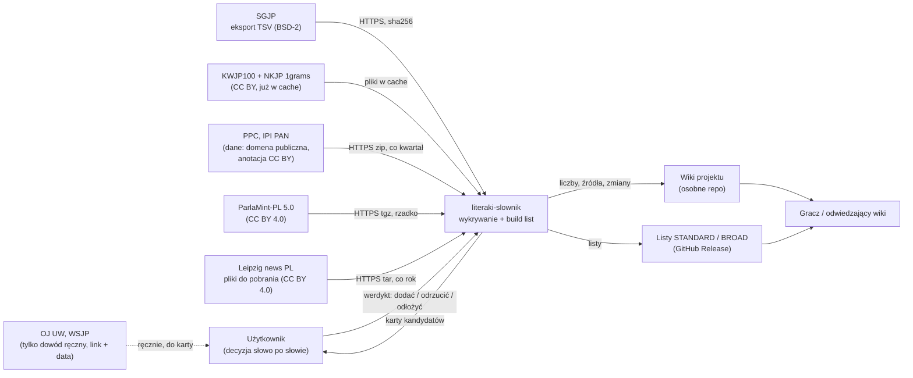
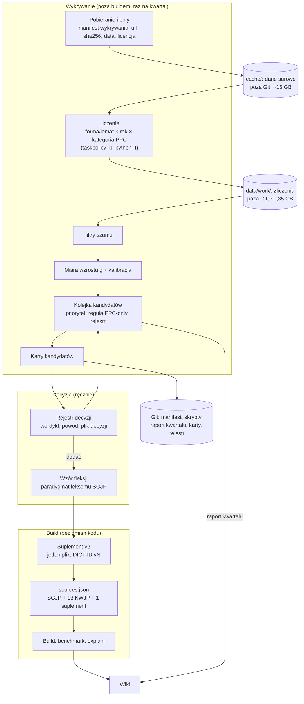
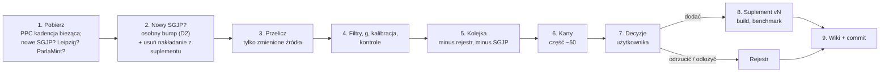

# Projekt: wychwytywanie nowych słów

Data: 2026-11-03 · Zgłoszenie: #16 · Wybory: D1-A, D2-A, D3-A, D4-A, P1-B, D5 odłożone · Decyzje: [decision-log.md](decision-log.md)

## TL;DR
- **Dwie osobne drogi.** Wykrywanie działa poza buildem: korpusy, liczby, karta kandydata. Wejście do list jest ręczne: decyzja użytkownika, potem wiersze w suplemencie v2.
- **Źródła wykrywania:** NKJP → KWJP (lata 2011–2020) oraz PPC, ParlaMint-PL 5.0 i Leipzig news (lata 2015–2026). Wszystkie przypięte przez sha256 w osobnym manifeście, nie w `sources.json`.
- **Suplement v2 zastępuje v1 w tym samym slocie.** Kod buildu się nie zmienia. Zmienia się jeden test.
- **Rytm kwartalny** z odświeżeniem PPC. Pierwsza paczka (~300 słów wartych gry) w częściach po ok. 50 kart.
- **Kandydaci tylko z PPC** nie potrzebują drugiego korpusu. Pełne karty dostają tylko te z sygnałem w posiedzeniach plenarnych: 73 grupy, trafność 34%. Pozostałe idą na listę skróconą (10%) albo są odłożone (leki i angielskie, 0%). Szczegóły w ADR-017.

## Kluczowe decyzje
- NKJP 1grams także do miary wzrostu, poza buildem — [ADR-014](decision-log.md#adr-014-nkjp-1grams-także-do-miary-wzrostu-poza-buildem).
- PPC, ParlaMint, Leipzig tylko do wykrywania; PPC w atrybucjach i na wiki — [ADR-015](decision-log.md#adr-015-ppc-parlamint-pl-50-i-leipzig-news-tylko-do-wykrywania).
- Suplement v2 w miejscu v1, fleksja według wzoru SGJP — [ADR-016](decision-log.md#adr-016-suplement-v2-słowo-po-słowie-w-miejscu-v1).
- PPC-only w trzech warstwach, bez wymogu drugiego korpusu — [ADR-017](decision-log.md#adr-017-kandydaci-tylko-z-ppc).
- Kwartał, rejestr decyzji, paczki po ok. 50 — [ADR-018](decision-log.md#adr-018-przegląd-kwartalny-i-pierwsza-paczka-w-częściach).

## Otwarte pytania i ryzyka
- **Trafność to oceny agenta**, bez konkordancji. Pierwsza część przeglądu użytkownika ją sprawdzi. Jeśli wyjdzie poniżej 50% w grupach z ≥ 2 korpusów, trzeba ostrzejszych progów.
- **Fleksja z wzoru** to decyzja redakcyjna. Zły wzór daje złe formy.
- **Grupa form ≠ leksem.** Ucinanie końcówek rozbija ok. 10% leksemów (`ługańsk` / `ługański`). Karta musi pokazać lemat do decyzji, a nie samą grupę.
- **Przymiotniki od nazw miejsc:** dopuszczalne według użytkownika. Wstępny odczyt RJP 2026 (`cache/constructions/rjp-2026.pdf`, s. 51, „Mała litera”, p. 4): przymiotniki od nazw własnych pisze się małą literą (np. warszawska, wiślańskie), więc norma ich nie wyklucza. Użytkownik potwierdza to przy pierwszym takim słowie (np. mariupolski).
- **Słowa potoczne** (boomer, ghosting, cringe, wulwa) są poza zasięgiem tych korpusów. To osobne badanie.
- **Dysk:** 16 GB danych przy 34 GB wolnego.

---

## Opis
**Problem.** SGJP rośnie wolno (eksport 20261018 dodaje 2 lematy). Gracze używają słów, których w nim nie ma: antyinflacyjny, ekoschemat, pełnoskalowy, deepfake. Projekt potrzebuje powtarzalnego sposobu, by takie słowa zauważyć i świadomie dodać.

**Rozwiązanie.** **Potok wsadowy** uruchamiany raz na kwartał, poza buildem. Pobiera i przypina korpusy, liczy formy rocznie, odsiewa szum, mierzy **wzrost g** i układa **kolejkę kandydatów**. Dla każdego kandydata powstaje **karta**. Użytkownik wydaje werdykt słowo po słowie. Zatwierdzone słowo dostaje pełną fleksję **według wzoru leksemu SGJP** i trafia do **suplementu v2**. Dalej działa zwykły build, benchmark i wiki.

**Kluczowe decyzje:**
- Korpusy nie wchodzą do buildu. Liczby trafiają tylko do karty.
- Jeden suplement, nowa wersja przy każdej zmianie.
- Drugi korpus nie jest wymagany. Kolejność ustalają: liczba korpusów, potem sygnał z posiedzeń plenarnych PPC.
- Kwartał wyznacza PPC, jedyne źródło, które rośnie.

## Architektura

### Kontekst (C4, poziom 1)

- Strzałki ciągłe to dane. Linia przerywana to dowód, który użytkownik sprawdza sam.
- SJP.pl nie jest źródłem. Służy tylko do porównania po buildzie, jak dziś. Wikisłownik jest odroczony.

### Kontenery (C4, poziom 2)

- **Wykrywanie** to skrypty z siecią tylko w kroku pobierania. Reszta czyta przypięte pliki, jak dziś przy TEMATY.
- **Decyzja** jest jedynym przejściem między wykrywaniem a buildem.
- **Build** nie wie o korpusach. Widzi tylko nową wersję suplementu.

## Komponenty

| Komponent | Cel | Zadania | Wejście / wyjście | Zależy od |
|---|---|---|---|---|
| **Pobieranie i piny** | Odtwarzalne dane wejściowe | pobranie (każdy plik do nowego, pustego katalogu); sha256; `retrieved_at`; zapis w manifeście wykrywania; odmowa przy niezgodnym pinie | url → plik w `cache/` + wiersz manifestu | sieć; wzór skryptu pobierania TEMATY |
| **Liczenie** | Liczby wystąpień w czasie | formy i lematy rocznie; dokumenty; wielkie litery; PROPN; dla PPC także kategoria (posiedzenia, komisje, interpelacje); tylko dokumenty z anotacją | pliki surowe → zliczenia w `data/work/` | `taskpolicy -b`, `python -I`, ≤ 6 procesów |
| **Filtry szumu** | Odsiać to, co nie jest słowem | litery polskie, długość ≥ 3; większość małą literą i nie PROPN; angielskie bez polskiej odmiany; literówka (1 edycja od częstszej formy SGJP); forma ucięta; etykieta domeny; fragment; jest w SGJP 20261018 lub w suplemencie; **flagi** (nie cięcie): lek lub łacina (końcówki typu -mab, -nib, -um), angielskie formy z -s | zliczenia → grupy form | SGJP, suplement |
| **Miara wzrostu** | Odróżnić nowe od starego | g = ipm po / ipm przed, +0,5, normalizacja przez medianę słów z SGJP; progi z ADR-014 (NKJP → KWJP) i z pomiaru korpusów (g ≥ 5, ≥ 10 po, ≥ 3 lata); kalibracja: odsetek słów SGJP, które przechodzą, i kontrole | grupy → grupy z g, flagą „nowe” | liczenie, filtry |
| **Kolejka kandydatów** | Kolejność przeglądu | łączy strumienie (374 i korpusy); odejmuje rozstrzygnięte w rejestrze i obecne w nowym SGJP; kolejność: ≥ 2 korpusy, Leipzig-only, PPC plenarne, lista skrócona PPC; flaga lek/angielski odkłada; części po ok. 50 | grupy → kolejka z priorytetem | rejestr, ADR-017 |
| **Karta kandydata** | Wszystko do decyzji na jednym ekranie | lemat do decyzji i klasa; liczby rocznie w każdym korpusie, g, KWJP F, NKJP; Słowosieć tak/nie; ≤ 2 krótkie przykłady z atrybucją; linki OJ UW / WSJP z datą odczytu; flagi szumu; proponowany wzór fleksji i pełna lista form; przewidywany wpływ (+ formy w STANDARD i BROAD) | kandydat → karta w repo | kolejka, wzór fleksji |
| **Rejestr decyzji** | Pamięć między kwartałami | werdykt dodać / odrzucić / odłożyć, data, powód, plik decyzji z sha256; zasady powrotu (ADR-018) | werdykt użytkownika → rejestr w repo | użytkownik |
| **Wzór fleksji** | Pełna fleksja zgodna z SGJP | wskazanie leksemu wzorcowego (ta sama klasa i odmiana); podmiana tematu w paradygmacie; kontrola tagów; lista form do karty | lemat + wzór → wiersze w formacie SGJP | eksport SGJP |
| **Suplement v2** | Jedyne wejście słów spoza SGJP | nowa wersja przy każdej zmianie; nagłówek z dwiema częściami i odsyłaczem do rejestru; usuwanie słów, które weszły do SGJP; `expected_counts` od nowa | wiersze → plik + wpis w `sources.json` | ADR-016 |
| **Build, benchmark, wiki** | Istniejący łańcuch wydania | build i `explain` jak dziś; benchmark z SJP.pl tylko jako porównanie; aktualizacja wiki według runbooka | suplement → listy → wiki | istniejący kod |

## Przepływ kwartalny

1. **Pobranie.** Co kwartał tylko bieżąca kadencja PPC (2,7 GB, rośnie). Pozostałe źródła tylko przy nowej wersji: SGJP przy nowym eksporcie, Leipzig raz w roku, ParlaMint rzadko. Każdy plik dostaje pin.
2. **SGJP.** Nowy eksport podbijamy osobno, przed przeglądem. Z suplementu usuwamy leksemy, które SGJP już ma.
3. **Liczenie** pod `taskpolicy -b`, ok. 20 min dla kadencji PPC. Baza 2015–2019 jest liczona raz.
4. **Filtry, g, kontrole.** Kontrole co kwartał: hejt i hejter (stare, mają odpaść), lockdown, covidowy, pandemia (mają przejść). Jeśli kontrola zmienia wynik, przebieg się zatrzymuje.
5. **Kolejka:** odejmujemy rozstrzygnięte i obecne w SGJP. Kolejność według ADR-017.
6. **Karty** dla jednej części, ok. 50.
7. **Decyzja** użytkownika słowo po słowie, z przykładami i wpływem (zasada z `AGENTS.md`).
8. **Dla „dodać”:** wzór fleksji, wiersze, plik decyzji, nowa wersja suplementu, testy, build, benchmark.
9. **Wiki i commit** w tej samej pracy.

## Gdzie co leży

| Co | Gdzie | Git? | Uwagi |
|---|---|---|---|
| Surowe korpusy (PPC 11 GB, ParlaMint 2,2 GB, Leipzig 3 GB) | `cache/` | nie | jak dziś KWJP i NKJP; ponowne pobranie musi dać pin |
| Zliczenia, grupy, pośrednie pliki | `data/work/` | nie | odtwarzalne skryptem |
| Manifest wykrywania (url, sha256, data, licencja, atrybucja) | `config/` obok `sources.json` | tak | osobny plik; build go nie czyta |
| Skrypty pobierania i liczenia | `scripts/` | tak | sieć tylko w pobieraniu |
| Raport kwartału: liczby, kalibracja, kontrole | `.maister/tasks/…` | tak | liczby pochodne z atrybucją CC BY |
| Karty kandydatów | `.maister/tasks/…` | tak | ≤ 2 krótkie przykłady na kartę, z atrybucją |
| Rejestr decyzji | `config/` | tak | jeden plik, czytany przez kolejkę |
| Pliki decyzji (dowody słowa) | `.maister/tasks/…/analysis/evidence/` | tak | sha256 w `evidence` suplementu |
| Suplement v2 | `config/generator/` (ta sama ścieżka co v1) | tak | BSD-2, własne dane projektu |
| Atrybucje PPC, ParlaMint, Leipzig | `ATTRIBUTIONS.md` | tak | NKJP już jest (ADR-006) |

**Nie wolno w repo:** surowych plików korpusów, pełnych list frekwencyjnych, długich fragmentów tekstu, niczego ze strony lub API Leipzig (CC BY-NC).

## Limit suplementów w `inputs.py`
**Rozstrzygnięcie: v2 zastępuje v1, kod się nie zmienia** ([ADR-016](decision-log.md#adr-016-suplement-v2-słowo-po-słowie-w-miejscu-v1)).
- Tryb produkcyjny nadal wymaga 14 + 1 artefaktów. Zmienia się `source_id` (`sgjp-supplement-v2`), `version`, sha256, `license_scope`, `dependencies` i `expected_counts`.
- Lista `evidence` rośnie o plik decyzji każdej paczki. Kod sprawdza sha256 każdego z nich.
- Zmienia się jeden test: sprawdzenie „dokładnie 4 wiersze” zastępuje sprawdzenie „4 wiersze zaimka są w pliku”.
- Zmiana kodu byłaby potrzebna dopiero dla drugiego, niezależnego suplementu. Dziś nie ma takiej potrzeby.

## Kandydaci tylko z PPC (pomiar)
Pomiar z 2026-11-03: PPC przeliczony z podziałem na kategorie dokumentów. Oceny agenta: 100 losowych grup i wszystkie 78 z sygnałem plenarnym. Pełna tabela jest w [ADR-017](decision-log.md#adr-017-kandydaci-tylko-z-ppc).

| Warstwa kolejki | grupy | trafność | słów A (szac.) |
|---|---|---|---|
| ≥ 2 korpusy | 243 | 70% | ≈ 170 |
| Leipzig-only | 87 | 50% | ≈ 45 |
| PPC: ≥ 5 użyć w posiedzeniach plenarnych, bez flagi | 73 | 34% | 25 |
| PPC: reszta bez flagi (lista skrócona) | 365 | 10% | ≈ 37 |
| PPC: flaga lek/angielski (odłożone) | 107 | 0% (0/33) | ≈ 0 |
| *dla porównania: wymóg 2. korpusu* | *0 z 545* | — | *traci ≈ 60–70* |
| *dla porównania: wzrost tylko w plenarnych (g ≥ 5, ≥ 10 po, ≥ 3 lata)* | *33* | *42%* | *14; traci 11 z 25* |

W posiedzeniach plenarnych fałszywe alarmy na słowach z SGJP to 5,4%. W całym PPC jest to 15,6%.

## Punkty integracji
- **Wejście:** HTTPS do PPC (`kdp.ipipan.waw.pl`, bez konta), ParlaMint (CLARIN.SI), Leipzig (pliki do pobrania), SGJP (`download.sgjp.pl`). Nic z formularzem, kontem ani mailem.
- **Istniejące dane w `cache/`:** KWJP100, NKJP 1grams, SGJP, Słowosieć 4.5 (tylko do porządkowania kandydatów, ADR-011).
- **Build:** jedyny styk to plik suplementu i jego wpis w `sources.json`.
- **Wiki:** osobne repozytorium, aktualizowane według `docs/runbook-wiki.md`.
- **Dowód ręczny:** OJ UW i WSJP tylko jako link z datą odczytu w karcie. Bez pobierania danych.

## Zmiany w wiki
Zasada repo: zmiana źródeł lub kryteriów aktualizuje wiki w tej samej pracy.

| Strona | Kiedy | Co zmienić |
|---|---|---|
| `Home` | przy ADR-014/015 i przy D2 | tabela źródeł: wiersze PPC, ParlaMint-PL 5.0, Leipzig news i NKJP z opisem „tylko do wykrywania nowych słów, nie do list”; data eksportu SGJP; wiersz suplementu: „się, siebie… oraz nowe słowa spoza SGJP, każde decyzją” |
| `Slownik-STANDARD`, `Slownik-BROAD` | przy pierwszym „dodać” | „co wchodzi”: słowa spoza SGJP z suplementu, z przykładem (antyszczepionkowiec); liczby słów po buildzie |
| **nowa** `Nowe-slowa` | przy pierwszej części | jak wychwytujemy: źródła i atrybucje, kryteria (wzrost, szum, reguła PPC-only), rytm kwartalny, czego te korpusy nie widzą (słowa potoczne), liczby ostatniego kwartału, link do rejestru decyzji |
| `_Sidebar` | razem z `Nowe-slowa` | link do nowej strony |
| `Historia-zmian` | przy każdym buildzie z nową wersją suplementu i przy D2 | wiersz: wersja, data, ile słów dodano, przykład |
| `Porownanie-z-SJP.pl` i strony generowane | po buildzie | nowy benchmark (tylko porównanie, nie źródło kandydatów) |
| `Slownik-POP`, `POP0`, `POP00`, `TEMATY` | bez zmian | nowe słowa nie wchodzą tam, dopóki tych pakietów nie przebudujemy |

Poza wiki trzeba też dopisać sekcję „Nowe słowa” do `docs/runbook-wiki.md`, ADR do `docs/adr/` i wpisy do `.maister/docs/INDEX.md`. To już praca wdrożenia.

## Decyzje projektowe

| ADR | Decyzja | Odrzucone |
|---|---|---|
| [ADR-014](decision-log.md#adr-014-nkjp-1grams-także-do-miary-wzrostu-poza-buildem) | NKJP do miary wzrostu, poza buildem | bez NKJP; baza z jednego korpusu |
| [ADR-015](decision-log.md#adr-015-ppc-parlamint-pl-50-i-leipzig-news-tylko-do-wykrywania) | 3 korpusy tylko do wykrywania, osobny manifest | w buildzie; FineWeb-2/HPLT; żaden |
| [ADR-016](decision-log.md#adr-016-suplement-v2-słowo-po-słowie-w-miejscu-v1) | suplement v2 w miejscu v1 | drugi suplement i zmiana limitu; nowe źródło |
| [ADR-017](decision-log.md#adr-017-kandydaci-tylko-z-ppc) | PPC-only w 3 warstwach (sygnał plenarny) | wymóg 2. korpusu; wzrost tylko w plenarnych; bez reguły |
| [ADR-018](decision-log.md#adr-018-przegląd-kwartalny-i-pierwsza-paczka-w-częściach) | kwartał, rejestr, części po ~50 | przy SGJP; przy korpusie; na żądanie |

## Przykłady

**1. Słowo z kilku korpusów (antyinflacyjny).**
Mamy: PPC 0 → 1 589, Leipzig 0 → 328, ParlaMint 0 → 191, brak w SGJP, KWJP F = 8.
Gdy kwartał zbuduje kolejkę,
wtedy słowo jest w pierwszej części (≥ 2 korpusy). Karta pokazuje wzór fleksji (przymiotnik, np. `inflacyjny`) i formy. Po „dodać” suplement dostaje nową wersję, a build daje słowo w STANDARD i BROAD.

**2. Próba (antyszczepionkowiec).**
Mamy: KWJP 34, ParlaMint 93, PPC 146, OJ UW i WSJP (ręcznie, z datą).
Gdy użytkownik zatwierdzi słowo,
wtedy powstaje suplement v2: 4 wiersze zaimka i ok. 12 form według wzoru `związkowiec` (m1). `inputs.py` przyjmuje manifest bez zmian kodu. Wiki `Home`, `Slownik-STANDARD`, `Slownik-BROAD` i `Historia-zmian` dostają wpis.

**3. Szum tylko z PPC (pertuzumab, `zzd`).**
Mamy: pertuzumab 318 w 2021 (interpelacje), brak w innych korpusach; `zzd` to skrót.
Gdy kolejka stosuje ADR-017,
wtedy pertuzumab dostaje flagę „lek” i trafia do warstwy odłożonej, bez karty. Wróci, gdy pojawi się w drugim korpusie. `zzd` nie ma sygnału plenarnego, więc ląduje na liście skróconej. Użytkownik go nie zaznacza, a rejestr zapisuje „odrzucić: skrót”.

**4. Słowo tylko z PPC, z sygnałem plenarnym (patostreaming).**
Mamy: PPC 558 (273 w posiedzeniach plenarnych, 0 przed 2020), Leipzig 0, ParlaMint 0.
Gdy kolejka stosuje ADR-017,
wtedy słowo dostaje pełną kartę w warstwie plenarnej mimo braku drugiego korpusu.

**5. Nowy eksport SGJP ma słowo z suplementu.**
Gdy kwartał wykryje leksem w nowym SGJP,
wtedy usuwamy go z suplementu (nowa wersja). Licznik `duplicates` zostaje 0, a lista się nie zmienia.

## Poza zakresem
- Słowa potoczne i internetowe (boomer, ghosting, cringe) oraz wulwa: osobne badanie (D5).
- FineWeb-2, HPLT: licencja tekstu nieustalona.
- Wikisłownik (odroczony), SJP.pl (nie jest źródłem), kontakt z autorami.
- Automatyczny wpis po progu: sprzeczny z §4.4.
- Formacje z reguły (`anty-`, `post-`): każda tylko jako osobna decyzja.
- Warianty pisowni (boomer / bumer) i reforma pisowni RJP 2026: osobne tematy.
- Zmiany w POP, POP0, POP00, TEMATY.
- Konkretne pliki, nazwy poleceń i testy: to specyfikacja wdrożenia.

## Kryteria sukcesu
- Ten sam manifest daje te same zliczenia i tę samą kolejkę (odtwarzalność bajtowa raportu).
- Kontrole co kwartał: lockdown, covidowy, pandemia przechodzą; hejt i hejter odpadają.
- Pierwsza część z grup z ≥ 2 korpusów ma trafność użytkownika ≥ 50% (agent: 70%).
- Build z suplementem v2 przechodzi `inputs.py` bez zmiany kodu; każde dodane słowo ma pełny paradygmat i plik decyzji.
- Słowo odrzucone nie wraca w kolejnym kwartale bez nowego dowodu.
- Wiki jest zaktualizowana w tej samej pracy co build.
